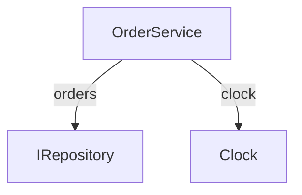

# Injectify

[](https://www.nuget.org/packages/Injectify.Auto)
[](https://www.nuget.org/packages/Injectify.Auto)
[](https://github.com/Roma1011/Injectify/actions/workflows/release.yml)
[](https://github.com/Roma1011/Injectify/blob/main/LICENSE)

## ⚡ Overview
This project provides a utility for automatically registering services in a .NET application using custom attributes (`Singleton`, `Scoped`, and `Transient`). It simplifies the process of configuring dependency injection by scanning assemblies and registering services based on their lifetime.


## 🚀 Features

- 🛠️ **Custom Attributes**: Use `[Singleton]`, `[Scoped]`, and `[Transient]` to define the lifetime of your services.
- 🔄 **Automatic Registration**: Automatically scans assemblies and registers services with the appropriate lifetime in the `IServiceCollection`.
- 🏷️ **Interface Binding**: Pass the service type to the attribute, `[Scoped(typeof(IOrderService))]`, so only the class is marked and your interfaces stay free of attributes.
- 🛡️ **Early Errors**: Conflicting lifetimes or a wrong service type throw a clear exception at startup instead of failing silently.
- 🗺️ **Dependency Graph**: Generates a [Mermaid](https://mermaid.js.org) diagram of your services' constructor dependencies.


### 📦 Installation
Install the [Injectify.Auto](https://www.nuget.org/packages/Injectify.Auto) package from NuGet:

```bash
dotnet add package Injectify.Auto
```

Supports .NET 8, 9 and 10. The only dependency is `Microsoft.Extensions.DependencyInjection`.

## 📖 Usage
### 🔷 1. Define your services and annotate them with the appropriate lifetime attribute:

### Example 1: Scoped
```csharp
using Injectify.Attributes;

public interface IScopedLogger
{
    void Log(string message);
}

[Scoped(typeof(IScopedLogger))]
public class ScopedLogger : IScopedLogger
{
    public void Log(string message)
    {
        Console.WriteLine($"[Scoped] {message}");
    }
}
```
### Example 2: Singleton
```csharp
using Injectify.Attributes;

[Singleton]
public class GlobalConfiguration
{
    public string Environment { get; set; } = "Production";
}
```

### Example 3: Transient
```csharp
using Injectify.Attributes;

// Marking the interface with the same attribute as the class also binds them
// (the way earlier versions worked). The lifetimes must match.
[Scoped]
public interface IUserContext
{
    string GetUserId();
}

[Scoped]
public class UserContext : IUserContext
{
    public string GetUserId() => "user-123";
}

[Transient]
public class AuditService
{
    private readonly IUserContext _userContext;

    public AuditService(IUserContext userContext)
    {
        _userContext = userContext;
    }

    public void Audit(string action)
    {
        Console.WriteLine($"User {_userContext.GetUserId()} performed: {action}");
    }
}
```
### Example 4: Generic
```csharp
using Injectify.Attributes;

public interface IRepository<T>
{
    void Add(T item);
}

// Open generic class: pass the open generic service type.
// A closed class (UserRepository : IRepository<User>) uses typeof(IRepository<User>).
[Transient(typeof(IRepository<>))]
public class InMemoryRepository<T> : IRepository<T>
{
    private readonly List<T> _items = new();

    public void Add(T item)
    {
        _items.Add(item);
    }
}
```
### 🔷 2. Register the services in your Startup or Program class:
```csharp
using Microsoft.Extensions.DependencyInjection;

IServiceCollection services = new ServiceCollection();
services.AddInjectify(typeof(Program).Assembly);
```

In ASP.NET Core:
```csharp
builder.Services.AddInjectify(typeof(Program).Assembly);
```

`AddInjectify` lives in the `Microsoft.Extensions.DependencyInjection` namespace, next to `AddScoped` and `AddSingleton`. `AggregateLifeTime` from earlier versions still works, but is obsolete.

Each class is registered as:
1. the service type passed to its attribute, `[Scoped(typeof(IOrderService))]`; otherwise
2. the first interface marked with the same attribute; otherwise
3. the class itself.

Registrations that need a factory or a condition stay in code, next to `AddInjectify`:
```csharp
builder.Services.AddInjectify(typeof(Program).Assembly);
builder.Services.AddSingleton<IConnectionMultiplexer>(_ =>
    ConnectionMultiplexer.Connect(builder.Configuration.GetConnectionString("Redis")!));
```

### 🔷 3. (Optional) Draw the dependency graph
`DrawAggregator` builds a [Mermaid](https://mermaid.js.org) graph from the annotated classes. Each edge goes from a service to a constructor parameter and is labeled with the parameter name. Like `Microsoft.Extensions.DependencyInjection`, it uses the public constructor with the most parameters.
```csharp
using Injectify.Aggregator;

string graph = DrawAggregator.GenerateMermaidGraph(typeof(Program).Assembly);
Console.WriteLine(graph);
```

For a service like this:
```csharp
[Scoped(typeof(IOrderService))]
public class OrderService(IRepository<Order> orders, Clock clock) : IOrderService
{
    // ...
}
```

it prints:
```
graph TD
    OrderService -->|orders| IRepository
    OrderService -->|clock| Clock
```

Paste the output into [mermaid.live](https://mermaid.live), or into a `mermaid` code block in any Markdown file on GitHub, and it renders as a diagram:


### Attributes
```
[Singleton]: Registers the service with a singleton lifetime.
[Scoped]: Registers the service with a scoped lifetime.
[Transient]: Registers the service with a transient lifetime.

[Scoped(typeof(IService))]: Registers the class as IService. Works the same way for [Singleton] and [Transient].
                            Use typeof(IService<>) for open generic classes.
```

### ⚠️ Error Handling
`AddInjectify` checks the attributes while it scans and throws at startup, so a mistake never turns into a missing registration later. All errors derive from `InjectifyException` (namespace `Injectify.Exceptions`) and name the classes involved.

| Exception | When |
|---|---|
| `MultipleLifetimeException` | A class has more than one lifetime attribute. |
| `LifetimeMismatchException` | A class and its interface (or the service type passed to the attribute) have different lifetimes, e.g. a `[Transient]` class implementing a `[Scoped]` interface. |
| `InvalidServiceTypeException` | The service type passed to the attribute is not implemented by the class, or mixes open and closed generics. |
### 👨‍💻 Contributing
Feel free to submit issues or create pull requests to enhance Injectify.


